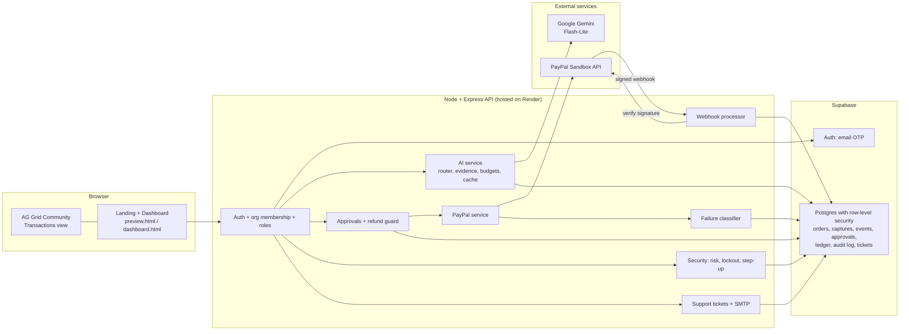
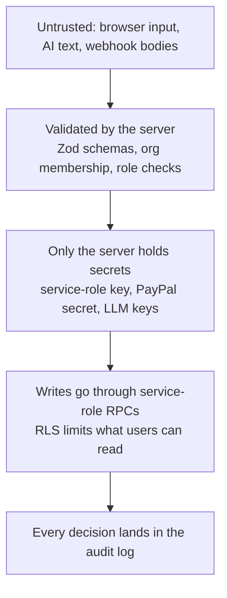
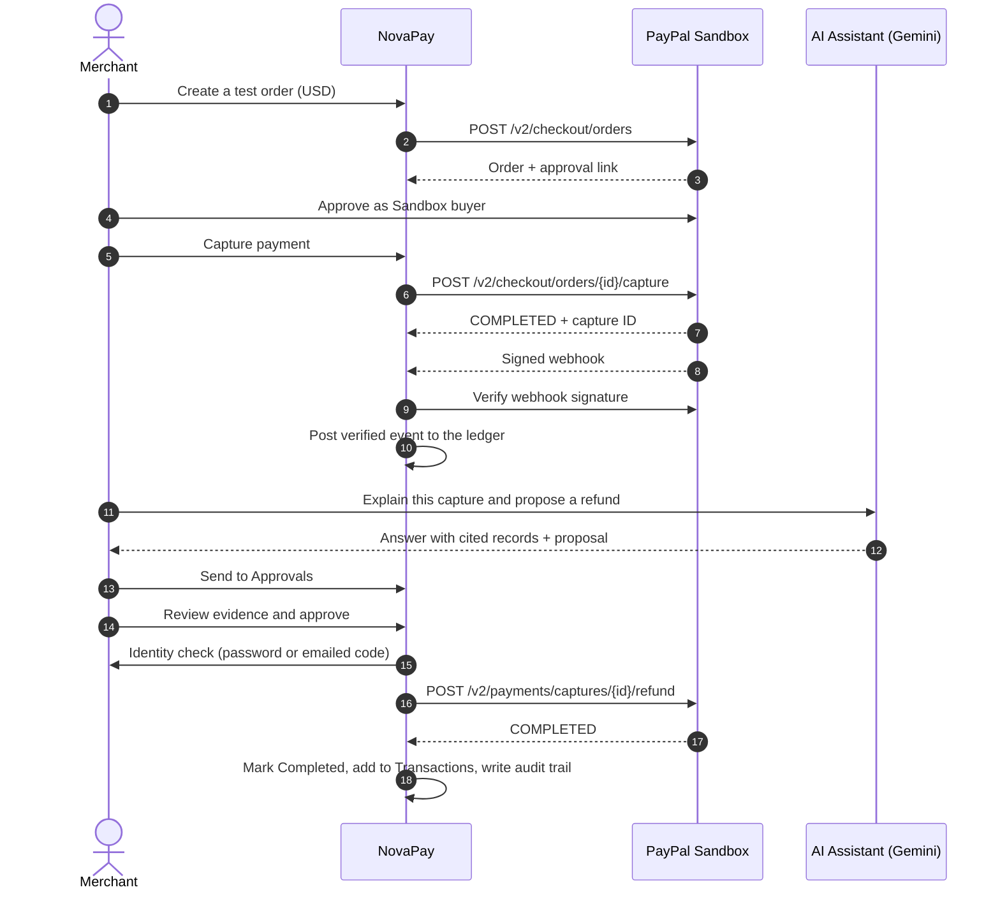
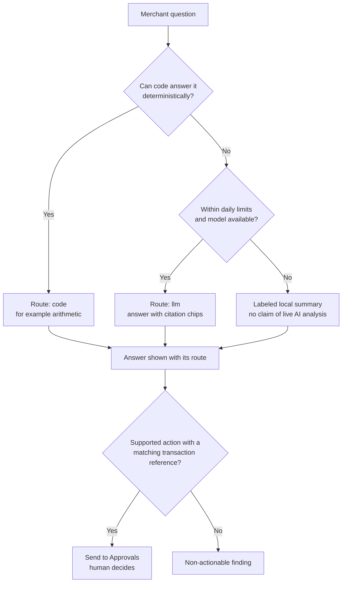
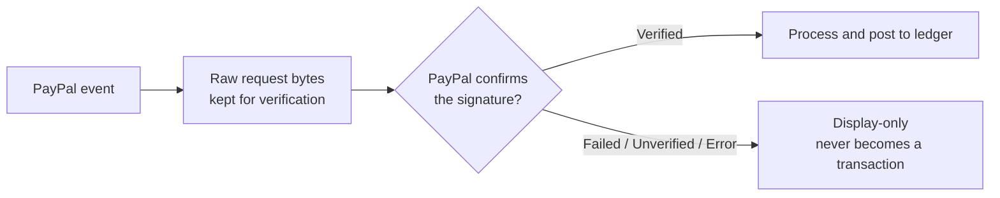

<div align="center">

# NovaPay

### The AI proposes. A human approves. PayPal executes.

**An AI-assisted, human-approved operations layer for PayPal merchants, built on the PayPal Sandbox.**

[](LICENSE)
[](package.json)
[](https://developer.paypal.com)
[](#how-the-ai-assistant-works)
[](#deployment-on-render)

**Live app:** https://novapay-20fz.onrender.com  
**Built for the PayPal AI Hackathon**

</div>

> **Scope notice.** NovaPay runs on the **PayPal Sandbox with test money only**. It does not move real funds and does not support production payments. Every feature below is labeled as **real** (works against PayPal Sandbox, Supabase or Gemini) or **simulated** (clearly marked in the UI). Anything that is vision rather than shipped code is labeled **Vision**.

---

## Table of contents

1. [The problem](#1-the-problem)
2. [What NovaPay is](#2-what-novapay-is)
3. [How NovaPay improves PayPal operations](#3-how-novapay-improves-paypal-operations)
4. [Hackathon requirements at a glance](#4-hackathon-requirements-at-a-glance)
5. [Architecture](#5-architecture)
6. [Workflows](#6-workflows)
7. [What is real and what is simulated](#7-what-is-real-and-what-is-simulated)
8. [Modules](#8-modules)
9. [How the AI assistant works](#9-how-the-ai-assistant-works)
10. [Approvals and refund safety](#10-approvals-and-refund-safety)
11. [Failure diagnosis](#11-failure-diagnosis)
12. [Security](#12-security)
13. [Support tickets](#13-support-tickets)
14. [Try it: judge quick start](#14-try-it-judge-quick-start)
15. [Run it locally](#15-run-it-locally)
16. [PayPal Sandbox setup](#16-paypal-sandbox-setup)
17. [Deployment on Render](#17-deployment-on-render)
18. [Our journey: problems we faced and how we solved them](#18-our-journey-problems-we-faced-and-how-we-solved-them)
19. [Who can use NovaPay](#19-who-can-use-novapay)
20. [Vision: business model and roadmap](#20-vision-business-model-and-roadmap)
21. [Current limits](#21-current-limits)
22. [Frontend notes](#22-frontend-notes)
23. [Tech stack, docs and license](#23-tech-stack-docs-and-license)

---

## 1. The problem

Running a business on PayPal means a steady stream of small but costly decisions: *Which payment looks wrong? Should this refund go through? Why did that request fail, and is it safe to retry? Does my ledger match what PayPal says happened?*

Merchants usually answer these questions by hand, across dashboards, exports and spreadsheets. Three gaps make this hard:

| Gap | What it looks like for a merchant |
| --- | --- |
| **Slow, manual review** | Refunds, odd fees and duplicate payments are found by scanning lists. Nothing explains *why* an item looks unusual, and nothing points to the evidence. |
| **Opaque failures** | When an API call fails, the raw provider response is technical and easy to misread. It is unclear whether a retry is safe or could create a duplicate. |
| **Weak trust in automation** | An AI that can touch money is risky. Without human approval, evidence and an audit trail, nobody can responsibly let it act. |

Plain automation fails on trust. Plain dashboards fail on speed. NovaPay is built for the space between.

---

## 2. What NovaPay is

NovaPay is a merchant workspace that sits next to PayPal. It reads a merchant's PayPal Sandbox activity, explains it, and proposes actions, but **it never acts on its own**.

```
        AI suggests            Human approves            PayPal Sandbox executes
   ┌──────────────────┐     ┌──────────────────┐     ┌───────────────────────────┐
   │ Cited evidence   │ ──▶ │ Approvals queue  │ ──▶ │ Refund / capture via the  │
   │ from your records│     │ + identity check │     │ PayPal Sandbox API        │
   └──────────────────┘     └──────────────────┘     └───────────────────────────┘
                                      │
                                      ▼
                         Audit trail + signed-webhook ledger
```

**The principles behind it**

- **Human in the loop, always.** The AI never executes. Every action passes the Approvals queue, and refunds need an extra identity check.
- **Evidence over answers.** AI answers cite the records they came from, and anything the model cannot support is shown as a non-actionable finding.
- **Honest about what is real.** Simulated features are labeled simulated. The app never claims delivery or execution that did not happen.
- **Safe by default.** Refunds only target an exact completed capture, retries are deduplicated, and uncertain results block duplicate submission.

---

## 3. How NovaPay improves PayPal operations

| Area | Without NovaPay | With NovaPay |
| --- | --- | --- |
| **Reviewing activity** | Scan transaction lists by hand | Ask the AI Assistant in plain language and get cited evidence |
| **Refund decisions** | Decide from memory or a spreadsheet | The AI proposes with reason and evidence, a human reviews, and a Sandbox refund runs only after approval and identity check |
| **Failed requests** | Read raw API errors | Failures are classified into a safe cause, retry guidance and a request reference |
| **Reconciliation** | Compare PayPal and books manually | PayPal-signed webhooks are verified and posted to a journal-based ledger; unverified events stay display-only |
| **Accountability** | Scattered notes | A newest-first audit trail of who decided what, when, and what PayPal returned |
| **Account safety** | Trust the password alone | Device and sign-in risk, lockouts, and re-authentication on sensitive actions |

---

## 4. Hackathon requirements at a glance

| Requirement | How NovaPay meets it |
| --- | --- |
| **PayPal developer platform (free Sandbox)** | Orders API v2 (create, capture), Payments Refunds API, and Webhooks with signature verification. See [PayPal Sandbox setup](#16-paypal-sandbox-setup). |
| **An AI tool, model or platform** | Google Gemini (free-tier Flash-Lite, with a fallback model) for the assistant, document OCR and embeddings. An optional Anthropic adapter is built in and off by default. See [How the AI assistant works](#9-how-the-ai-assistant-works). |
| **Sponsor tools (optional)** | **AG Grid Community** powers the Transactions grid. **Render** hosts the app. |
| **Public repository, OSI license, setup instructions** | MIT license, plus [Run it locally](#15-run-it-locally) and [Deployment on Render](#17-deployment-on-render). |

---

## 5. Architecture

### System overview



### Trust boundaries



---

## 6. Workflows

### Payment, AI review, approval and refund



### How the AI assistant routes a question



### Webhook trust path



---

## 7. What is real and what is simulated

**Real** (PayPal Sandbox, Supabase, Gemini):

- Test payments (create and capture an order) and refunds through PayPal Sandbox.
- Signed webhook verification. Verified captures and refunds are posted to the ledger.
- Sign-in through Supabase Auth with email one-time codes, and organization-scoped row-level security (RLS).
- Persistence in Supabase Postgres when configured: PayPal orders, captures and webhook events, approvals and the audit trail, ledger entries, failures, security records and support tickets.
- Support email through configured SMTP, with real stored status and delivery tracking.
- AI answers with cited evidence from your organization's records, using the configured free-tier Gemini model.

**Simulated** (always labeled in the UI):

- **Invoice sending.** No PayPal invoice is sent and no recipient is notified. Approval gating and local tracking are real.
- **Dashboard seed figures, illustrative transactions and starter proposals** shown before real data exists.
- **Dispute evidence and payout holds.** Approving these does not call PayPal.
- **Local demo mode.** If Supabase is unreachable, the front end falls back to a clearly labeled, browser-only sample session ("DEMO MODE"). It is not the primary path and it has no backend account behind it. The live deployment uses real sign-in.
- **No external help desk** is connected. With no SMTP configured, tickets are stored but no email is sent.

**Persistence note.** With the three Supabase keys configured, approvals, the audit trail and created-order state are stored in Postgres. Without them the server runs in an explicit **degraded mode**: protected APIs are unavailable and any in-process state is not durable.

---

## 8. Modules

| Module | What it does |
| --- | --- |
| **Dashboard** | Cash flow overview from the organization's ledger cash accounts, separated by currency. |
| **Transactions** | AG Grid view with sorting, date and amount filters, pagination, selection, per-currency totals and CSV export. |
| **AI Assistant** | Full-page conversation with cited evidence and action proposals. |
| **Approvals** | Human review queue with evidence, identity check and audit trail. |
| **PayPal Sandbox** | Create and capture test orders, webhook event list, failure diagnosis. |
| **Ledger** | Journal-based records of verified payments and refunds. |
| **Invoices** | Draft, track and approve invoices. Sending is simulated. |
| **Reports** | Organization reporting from stored records. |
| **Documents** | Upload documents for OCR and search (Gemini OCR and embeddings; default limits are 10 MB and 10 pages). |
| **Security** | Real sign-ins, known devices, explainable risk and lock status. |
| **Help & support** | Ticketing with staff queue and tracked email delivery. |

*Optional modules (Community Funds and Maintenance) exist in the codebase but are disabled by default (`ENABLE_COMMUNITY_FUNDS=false`, `ENABLE_MAINTENANCE=false`) and are not part of this submission.*

---

## 9. How the AI assistant works

The assistant answers questions about your organization's records and can propose a supported action. Each question takes one of two routes, and the UI shows which:

- **`code`**: deterministic answers, such as arithmetic, computed in code and never guessed by a model.
- **`llm`**: answers from the configured model, with citation chips pointing to the records used.

**Guardrails**

- Gemini free-tier Flash-Lite is the default model, with a fallback model. The Anthropic adapter is optional (`LLM_PROVIDER`, `ANTHROPIC_API_KEY`).
- The model only sees an allow-listed context with common PII patterns redacted.
- Per-user and per-organization daily limits, input and output size caps, and an answer cache keep the free tier usable.
- If no model is available, the assistant falls back to a **labeled local summary** that does not claim live AI analysis and does not detect fraud. AI service status and transaction-data status are shown separately.
- Anomaly signals (fee spikes, duplicates, high refund rates, large payouts, stale webhooks) are rule-based, with thresholds set in `.env.example`.

**The assistant never executes an action.** A supported proposal with a matching transaction reference shows its reason and evidence separately, and **Send to Approvals** places it in the queue. Missing references and unsupported action types stay as non-actionable findings.

---

## 10. Approvals and refund safety

The queue shows source, action type, reason, transaction reference, amount, evidence, status, and whether the action runs in PayPal Sandbox or is simulated only. You can filter by status, type and source. **Review proposal** opens the full evidence, and a second confirmation is required before any Sandbox request.

- Only a refund tied to an **exact completed USD capture** can execute against PayPal Sandbox. The backend registers the proposal ID, capture ID, amount and currency, then checks the link and the remaining refundable amount before sending. It **never falls back to the latest capture**.
- A refund is marked Completed and added to Transactions **only after PayPal returns `COMPLETED`**.
- Dispute evidence, payout holds, and unsupported or unlinked proposals are simulated or informational. Approving them does not call PayPal.
- Failed requests stay in the queue and can be retried or rejected. If PayPal returns an uncertain status, **duplicate submission is blocked** until the Sandbox state is checked.
- Rejection never calls PayPal and can carry a note.
- The newest-first **audit trail** records proposal ID, action type, decision, decision time, reviewer, reference, PayPal result ID and status, and any errors.

---

## 11. Failure diagnosis

PayPal Sandbox API errors are classified from documented provider issue codes and HTTP status. The organization-scoped `/api/failures` feed records the **safe cause, retry guidance, request reference and sanitized provider issue identifiers**. It never stores full provider payloads or credentials.

- A retry is presented as safe **only when the classifier says the request can be retried**.
- Network, provider and payment-method outcomes remain PayPal Sandbox results. Anomaly detection and cause wording are local NovaPay behavior.
- Failure evidence also feeds the AI assistant and anomaly checks.

---

## 12. Security

- **Authentication.** Supabase Auth with email one-time codes. Email confirmation is on, and requests are preflighted against a disposable-email denylist and in-memory rate limits.
- **Tenant isolation.** Organization-scoped row-level security. Writes go through backend service-role RPCs, and execution is revoked from public roles.
- **Risk and devices.** Sign-in and device risk is recorded using salted hashes of the network range and browser signature. Raw IP addresses are not stored. The Security panel shows real recent sign-ins, known devices, explainable risk reasons and lock status.
- **Lockouts.** Failed sign-ins are recorded and trigger account and network-prefix lockouts, before login and on authenticated API requests. Owners and admins can unlock a member. Direct attempts against Supabase Auth remain subject to Supabase's own rate limits.
- **Step-up re-authentication.** Sensitive refund approvals and invoice sends can require password or emailed-code re-authentication, using short-lived grants tied to a registered device. Removing a device ends its grant.
- **Secrets.** Service-role and provider keys stay on the server and never go to browser code or commits.
- **Out of scope in this release.** MFA and TOTP enrollment. The browser security policy runs in report-only mode, and suspicious-message checks are deterministic heuristics, not a guarantee. The Security panel only shows data recorded after the security migrations were applied; earlier sign-ins are not backfilled.

---

## 13. Support tickets

Support cases receive sequential organization-local numbers such as `NP-0007`. Regular users see only the number, topic and subject in **Settings → Help & support**, and replies go to the account email on file. The queue is available to support members, owners and admins, with assignment, status and priority controls. Internal notes stay in the staff view and are never emailed.

SMTP delivery is real when configured, and each message shows *sent*, *failed* or *not configured*; staff can retry failed delivery. Ticket storage, role checks, notifications and email tracking are NovaPay behavior, and no external help desk is connected.

Configure `SMTP_HOST`, `SMTP_PORT`, `SMTP_USER`, `SMTP_PASS`, `SMTP_FROM` and optionally `SUPPORT_INBOX_EMAIL` on the server. Grant the support role with:

```sh
node scripts/grant-support-role.js <org-uuid> <user-uuid>
```

---

## 14. Try it: judge quick start

**Live app:** https://novapay-20fz.onrender.com  
If the first load is slow, the server may be waking up. Give it up to a minute.

Credentials for the PayPal Sandbox buyer (and an optional ready-made NovaPay login) are supplied in the Devpost submission's testing instructions. They are never committed to this repository.

**Five-minute walkthrough**

1. **Sign in.** Choose **Get Started**, create an account with an email you can read, enter the emailed 6-digit code, and the dashboard opens. (Or use the ready-made judge login if provided.)
2. **Make a Sandbox payment.** Open **PayPal Sandbox**, create a USD test order, open the approval link and approve as the Sandbox buyer. Back in NovaPay, choose **I approved the order · Capture payment**.
3. **See failure diagnosis.** In **PayPal Sandbox**, review the cause category, safe retry guidance and next step for failed requests.
4. **Ask the AI.** Open **AI Assistant**, ask it to explain the capture and propose a refund, and click **Send to Approvals**.
5. **Approve with safeguards.** Review the evidence in **Approvals** and approve. Complete the identity check (choose password and use the account password). The refund executes in Sandbox, a transaction row appears and the audit trail records it.
6. **Explore.** Open **Settings → Security** for sign-in risk and devices, and **Help & support** to submit a ticket.

---

## 15. Run it locally

1. Copy `.env.example` to `.env` (git-ignored) and fill in the keys for the services you use: `SUPABASE_URL`, `SUPABASE_ANON_KEY`, `SUPABASE_SERVICE_ROLE_KEY`, `PAYPAL_CLIENT_ID`, `PAYPAL_CLIENT_SECRET`, `PAYPAL_WEBHOOK_ID`, `LLM_PROVIDER`, `LLM_API_KEY`, `LLM_MODEL`, `LLM_FALLBACK_MODEL` and `PAYPAL_INVOICE_SEND_MODE`. Document OCR and embeddings use `GEMINI_API_KEY` (or the numbered key pool in `.env.example`). **Keep the service-role and provider keys on the server. Never put them in browser code or commits.**
2. Install and start (Node 18 or later):

   ```sh
   npm ci
   npm start
   ```

   The API and dashboard use port 3000 by default. Open `http://localhost:3000/dashboard.html` and check `GET /api/status` before a demo.
3. Run the tests:

   ```sh
   npm test
   ```

   This runs the migration syntax checks and the server test suite.

Supabase migrations live in `supabase/migrations/` (numbered `0001` onward). Apply them in order through the Supabase SQL Editor, and run `npm run check:migrations` first. Never edit an applied migration; add a new numbered file.

**Degraded mode.** Without the three Supabase keys the server runs in an explicit degraded mode. Opening the HTML files without the backend shows clearly labeled demo data, and the sandbox integrations are unavailable. If the dashboard icons do not load over `file://`, serve the folder over HTTP (`python3 -m http.server`).

**Email sign-up setup.** See [`docs/AUTH-OTP-SETUP.md`](docs/AUTH-OTP-SETUP.md) for the Supabase email-code configuration and the cleanup command for unconfirmed accounts.

---

## 16. PayPal Sandbox setup

Create a PayPal developer Sandbox REST app and put its client ID and secret in `.env` as `PAYPAL_CLIENT_ID` and `PAYPAL_CLIENT_SECRET`.

**PayPal APIs used** (all against `api-m.sandbox.paypal.com`)

| API | Endpoint | What NovaPay uses it for |
| --- | --- | --- |
| Orders v2 | `POST /v2/checkout/orders` | Create USD test orders |
| Orders v2 | `POST /v2/checkout/orders/{id}/capture` | Capture approved orders |
| Payments v2 | `POST /v2/payments/captures/{id}/refund` | Execute approved refunds against an exact capture |
| Webhooks | `POST /v1/notifications/verify-webhook-signature` | Verify that events really came from PayPal |

**Make a payment**

1. Open **PayPal Sandbox**, create a test order (USD, 0.01 to 10,000.00) and open the returned approval link in a new tab.
2. Approve it as a Sandbox buyer, return to NovaPay and choose **I approved the order · Capture payment**.
3. NovaPay reports a capture only after the API returns `COMPLETED`. It then shows the capture ID, order ID, amount, currency, status and the fee when PayPal provides one.

Stable request IDs let PayPal deduplicate retries. If a capture result is uncertain, NovaPay blocks automatic resubmission, so check the state in Sandbox first.

**Sandbox account tips.** Use a **US Personal** buyer account, a USD seller, and a Visa at checkout.

**Webhooks.** Expose `http://localhost:3000` through a trusted HTTPS tunnel (or use your deployed URL) and set the Sandbox app's webhook URL to `https://<public-host>/api/webhook`. Configure the capture event you are testing, set `PAYPAL_WEBHOOK_ID` to that webhook's ID and restart the server. The tunnel must forward the **raw request bytes**, because signature verification needs them. The PayPal Sandbox page lists each event's type, PayPal event ID and received time, with one of **Verified**, **Failed**, **Unverified** or **Verification error**. Unverified events are display-only and never become transaction records. Do not share webhook signatures or credentials.

---

## 17. Deployment on Render

NovaPay is hosted on [Render](https://render.com) as a Node web service.

| Setting | Value |
| --- | --- |
| Runtime | Node 18 or later |
| Build command | `npm ci` |
| Start command | `npm start` |
| Port | Render's assigned port, read from `PORT` |
| Environment | All variables from `.env.example` set in the Render dashboard. Never commit them. |

After each deploy, check `GET /api/status` and confirm the PayPal webhook URL points at the deployed host. Free instances can sleep when idle, so the first request after inactivity may be slow.

---

## 18. Our journey: problems we faced and how we solved them

**How it started.** NovaPay began as a front-end concept: a polished dashboard showing what an AI-assisted PayPal workspace could look like. That first version was a static demo with sample data, and it did not connect to PayPal or any backend. It showed the idea, but it could not earn trust, because nothing it displayed was real.

**What we changed.** We rebuilt it in phases around one rule: *nothing the app claims may be untrue.* We added the backend and tenant-isolated data, then the PayPal financial core, then currencies, reports and invoices, then the AI assistant, then document OCR, and finally security hardening and support. Along the way we hit real problems, and each shaped the product.

| # | Problem we hit | How we solved it |
| --- | --- | --- |
| 1 | **A free-tier AI is limited and can be wrong.** Quotas run out, and a model should not do arithmetic or touch money. | Deterministic `code` routing for exact answers, per-user and per-organization limits, an answer cache, a Gemini key pool, a labeled local fallback, and cited evidence. The AI never executes. |
| 2 | **A refund could hit the wrong payment.** Linking by "latest capture" is dangerous. | Refunds register the proposal, capture ID, amount and currency, check the remaining refundable amount, and never fall back to the latest capture. |
| 3 | **Uncertain PayPal results invite duplicates.** A timeout does not say whether money moved. | Stable request IDs for deduplication, and automatic resubmission is blocked until the Sandbox state is checked. |
| 4 | **Raw PayPal errors are hard to use and risky to store.** | A classifier turns documented issue codes and HTTP status into a safe cause and retry guidance. Only sanitized issue identifiers are stored, never full payloads. |
| 5 | **Live Invoicing send could not be verified.** A Sandbox invoice was created, but we could not reliably complete the send step, and we would not retry blindly. | Invoice sending is **honestly simulated** and labeled. Approval gating and local tracking stay real. We documented it as a known limit instead of faking delivery. |
| 6 | **Webhook proof was fragile.** Signature checks need the exact raw bytes, an unreachable webhook host leaves no signed proof, and the signature worker runs asynchronously. | The server keeps raw bodies, unverified events stay display-only, we pause payment tests until the webhook host resolves, and our verifier waits for a final processing state. |
| 7 | **Sandbox setup has sharp edges.** | We documented them: a US Personal buyer, a USD seller, a Visa at checkout, and a matching webhook ID. |
| 8 | **Multi-tenant money data needs strong isolation.** | Organization-scoped RLS, writes through service-role RPCs only, execution revoked from public roles, and an insert-only audit log. |
| 9 | **Database changes are risky.** The Supabase SQL Editor runs a migration in one transaction, and an error rolls everything back. | Numbered migrations checked by `npm run check:migrations`, and applied migrations are never edited. |
| 10 | **Accounts can be attacked.** | Disposable-email checks, rate limits, risk scoring, lockouts and step-up re-authentication on sensitive actions. |

**Where it stands.** NovaPay is now a working Sandbox product: real payments, captures, refunds and verified webhooks, an AI assistant that cites its evidence, a human approval gate with an audit trail, and a security and support layer around it.

---

## 19. Who can use NovaPay

- **Small and mid-size merchants on PayPal** who want faster, safer review of payments and refunds without building tooling.
- **Finance and operations teams** that need a documented approval trail and a ledger that matches what PayPal confirmed.
- **Accountants and bookkeepers** who reconcile PayPal activity for clients.
- **Developers and integrators** who want a reference for a safe human-in-the-loop pattern on PayPal's APIs.
- **Support teams** who need payment context when handling customer cases.

---

## 20. Vision: business model and roadmap

> **Vision, not shipped.** This section describes where NovaPay could go. None of it is implemented in this submission, and NovaPay is Sandbox-only today.

**How NovaPay could sustain itself**

- **Subscription per organization**, with tiers by team size and feature set (for example approvals and audit for small teams, security and support tooling for larger ones).
- **Usage-based AI add-on** for heavier assistant and document-processing volume.
- **Partner channel** for accountants and agencies who manage several merchant workspaces.

**Where it could grow**

- Live-mode PayPal support after a proper production-readiness and compliance review.
- Additional currencies, payout holds, and dispute evidence submission (listed in [Current limits](#21-current-limits) as not covered today).
- Real PayPal invoice sending, once the live create-and-send flow is verified end to end.
- MFA and TOTP, and a connected help desk.
- Full PayPal history import for richer evidence and reconciliation.

**Why it matters.** The same pattern of evidence, human approval, strict execution rules and an audit trail can make AI assistance safe enough to use on financial actions, which is the gap NovaPay is built to show.

---

## 21. Current limits

- The integration covers **USD Sandbox orders, capture, webhook-signature verification and the specifically approved refund route**. It does not cover production payments, other currencies, payout holds, dispute evidence submission or full PayPal history import.
- Invoice sending is simulated (see [Section 7](#7-what-is-real-and-what-is-simulated)).
- PayPal capture data may omit buyer, timestamp or fee. NovaPay marks those fields unavailable.
- Dashboard figures from seed data are illustrative and labeled as such.
- AI answers depend on the free-tier model and its quotas. When it is unavailable, the assistant falls back to a labeled local summary.
- MFA and TOTP are not part of this release.

---

## 22. Frontend notes

- **Transactions grid.** Uses AG Grid Community 33.3.2 (MIT), loaded from the vendored bundle at `assets/vendor/ag-grid/ag-grid-community-33.3.2.min.js` the first time the Transactions view opens. It provides sorting, filtering by date and amount, pagination, row selection, per-currency pinned totals and CSV export. If the bundle fails to load, the original table stays available. The assistant's `transactions.applyView` action accepts only a strict set of filters and sort fields.
- **Landing hero.** A CSS 3D laptop with five orbiting cards (`src/hero-laptop.*`, `src/hero-orbit.*`). The orbit constants `SLANT`, `SPEED`, `ZOOM` and `START` are at the top of `hero-orbit.js`. To remove the orbit, delete its CSS link and script tag in `preview.html`.
- **Header logo.** The forming animation is in `src/logo-intro.*`. Click the logo to replay it, or call `window.novapayLogoReplay()`.
- Reduced-motion preferences are respected throughout. On phones (700px and narrower) the hero uses a simpler layout.

---

## 23. Tech stack, docs and license

**Stack:** Node.js 18+, Express 5, Supabase (Auth and Postgres with RLS), PayPal Sandbox REST APIs, Google Gemini (optional Anthropic adapter), AG Grid Community, Nodemailer, Zod, Helmet, pdf-lib. Hosted on Render.

**Documentation**

| File | Contents |
| --- | --- |
| [`docs/API.md`](docs/API.md) | API reference |
| [`docs/RUNBOOK.md`](docs/RUNBOOK.md) | Operations and verification steps |
| [`docs/AUTH-OTP-SETUP.md`](docs/AUTH-OTP-SETUP.md) | Email one-time-code setup |
| [`docs/DECISIONS.md`](docs/DECISIONS.md) | Design decisions with reasons and rejected alternatives |
| [`docs/HANDOFF.md`](docs/HANDOFF.md) | Current implementation notes |
| [`CHANGELOG.md`](CHANGELOG.md) | Phase-by-phase history |
| [`docs/TEST-REPORT.md`](docs/TEST-REPORT.md), [`PHASE-8-TEST-REPORT.md`](PHASE-8-TEST-REPORT.md) | Test results |

**License:** [MIT](LICENSE).

---

<div align="center">

**NovaPay: let AI do the reading, let humans make the call, and let PayPal do the paying.**

</div>
